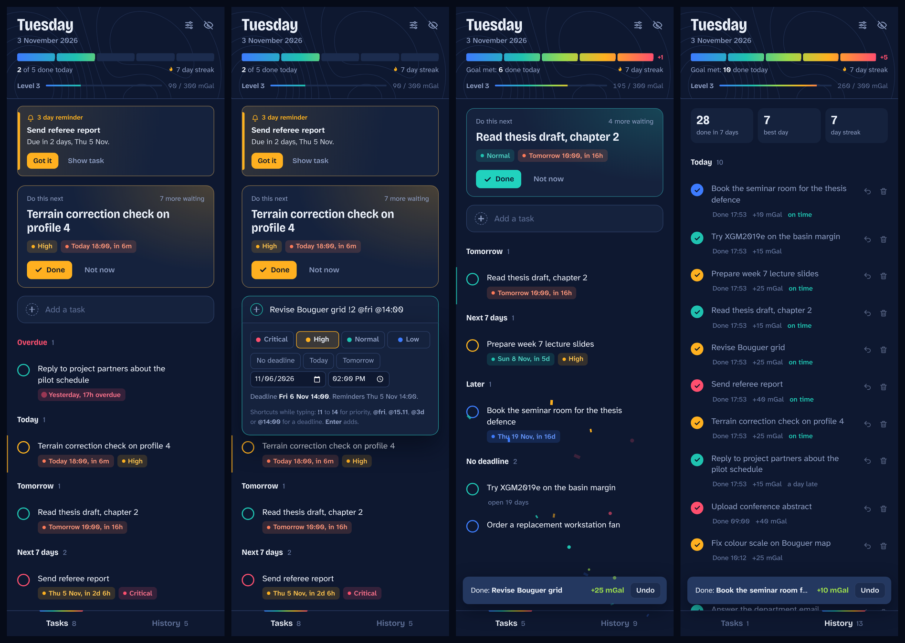

<p align="center">
  
</p>

<h1 align="center">FocusDock</h1>

<p align="center">
  A to do panel that lives on the edge of your leftmost screen and never leaves.<br>
  Urgency is drawn as heat, finishing things is loud on purpose, and reminders arrive before deadlines do.
</p>

<p align="center"><b>Windows 10 and 11</b> · version 1.0.0</p>



---

## Contents

1. [What FocusDock is](#1-what-focusdock-is)
2. [Highlights](#2-highlights)
3. [Requirements](#3-requirements)
4. [Installing, updating, uninstalling](#4-installing-updating-uninstalling)
5. [A tour of the panel](#5-a-tour-of-the-panel)
6. [Where the panel lives](#6-where-the-panel-lives)
7. [Adding tasks](#7-adding-tasks)
8. [Priorities](#8-priorities)
9. [Deadlines, groups and sorting](#9-deadlines-groups-and-sorting)
10. [Reminders](#10-reminders)
11. [Do this next](#11-do-this-next)
12. [Finishing tasks and rewards](#12-finishing-tasks-and-rewards)
13. [Editing and deleting](#13-editing-and-deleting)
14. [History](#14-history)
15. [Keyboard and mouse](#15-keyboard-and-mouse)
16. [The tray icon](#16-the-tray-icon)
17. [Settings reference](#17-settings-reference)
18. [Your data](#18-your-data)
19. [Troubleshooting](#19-troubleshooting)
20. [Customising beyond the settings](#20-customising-beyond-the-settings)
21. [Running and building from source](#21-running-and-building-from-source)
22. [How it works inside](#22-how-it-works-inside)
23. [Design notes](#23-design-notes)
24. [Known limitations](#24-known-limitations)
25. [Credits and licences](#25-credits-and-licences)
26. [Changelog](#26-changelog)

---

## 1. What FocusDock is

FocusDock is a narrow, always visible task panel for Windows. It docks itself to the edge of the leftmost monitor (or any monitor you choose) the way the Windows taskbar docks: it **reserves a strip of the screen**, so maximised windows stop at its edge instead of covering it. You never have to go looking for your list; it is simply there.

It was designed for a brain that loses track of things that are out of sight and that runs on small, frequent rewards:

* **Out of sight is out of mind**, so the panel is permanently visible and reminders persist until you acknowledge them.
* **Choice paralysis is real**, so one card at the top always answers "what now?".
* **Capture must be instant**, so one keyboard shortcut from anywhere opens the input, and typing `Email the editor !1 @fri` is a complete task.
* **Finishing should feel like something**, so every completed task sets off a ripple, confetti, a chime and points.

### Why it looks like a gravity map

The visual language is borrowed from geophysics. Urgency is drawn with the colormap of a Bouguer anomaly map: **blue is calm, teal is normal, amber is warm, red is hot**. The header carries faint contour lines of a synthetic gravity field that changes every day. Your daily progress is a **colorbar**, and experience points are counted in **mGal**. Every colour on screen means something; none of it is decoration.

---

## 2. Highlights

| Area | What you get |
|---|---|
| Placement | Docks as a Windows AppBar on the leftmost screen; maximised windows stop at its edge. Steps out of the way of full screen games and videos. Also works as a floating panel or a normal window. |
| Capture | Global shortcut **Ctrl+Alt+Space**. One line quick add with optional codes for priority (`!1`) and deadline (`@fri`, `@15.11`, `@3d`, `@14:00`), in English or Turkish day words. Live preview of what will be saved. |
| Organisation | Four priorities (Critical, High, Normal, Low). Deadlines with an optional time, or no deadline at all. Automatic groups: Overdue, Today, Tomorrow, Next 7 days, Later, No deadline. |
| Reminders | Every deadline reminds you **3 days and 1 day before**: a card in the panel that stays until you click Got it, plus a Windows notification that stays until dismissed. Missed reminders catch up when FocusDock starts. |
| Focus | A "Do this next" card that weighs priority against time pressure, with a Not now button to see the next candidate. |
| Rewards | Isoline ripple, confetti that falls under gravity, synthesised chimes, points in mGal, levels, a daily goal colorbar and a day streak. Calm mode turns all motion off. |
| Safety nets | Undo for completing and deleting (6 seconds, or Ctrl+Z). History keeps finished tasks with their completion time and whether they were on time; any of them can be restored. |
| Data | One local JSON file, written atomically, with an automatic backup on every start. Nothing leaves your PC. |

---

## 3. Requirements

* **Windows 10 or Windows 11**, 64 bit.
* Any number of monitors at any scaling. FocusDock works in device independent pixels, so a 380 pixel wide panel is 570 physical pixels on a 4K screen at 150%.
* About 350 MB of disk space for the installed app (it is an Electron app and carries its own copy of Chromium).
* To run or build from source: Node.js 22.12 or newer (see [section 21](#21-running-and-building-from-source)).

---

## 4. Installing, updating, uninstalling

### Install

1. Run **`FocusDock Setup 1.0.0.exe`**.
2. Windows SmartScreen will warn you, because the installer is not code signed. Click **More info**, then **Run anyway**.
3. The installer asks whether to install **for you only** or for everyone who uses the PC. *For you only* needs no administrator rights and installs into `%LOCALAPPDATA%\Programs\FocusDock`. It adds a Start menu shortcut (no desktop shortcut) and offers to start FocusDock on its last page.

On the first start FocusDock:

* docks to the left edge of your leftmost screen,
* registers itself to **start with Windows** (you can switch this off in Settings or from the tray),
* puts its icon (contour rings around a red core) in the notification area.

The panel has no taskbar button. It is always visible, and the tray icon is how you reach its menu.

**First thing to do:** open Settings (the slider icon at the top right) and press **Send a test** under Reminders. You should see a test card in the panel and a Windows notification. If the card appears but the notification does not, see [Troubleshooting](#19-troubleshooting).

### Update

Run the newer installer over the existing installation. Your tasks and settings are stored separately (see [Your data](#18-your-data)) and are kept.

### Uninstall

1. Optional but recommended: switch off **Start with Windows** first (Settings, or the tray menu), so no startup entry is left behind pointing at a program that no longer exists.
2. Quit FocusDock from the tray menu.
3. Remove it in **Windows Settings, Apps**.

Your data folder `%APPDATA%\FocusDock` is deliberately **kept**. Delete it by hand if you want your tasks gone too.

---

## 5. A tour of the panel

From top to bottom:

```
┌────────────────────────────────────┐
│ Tuesday                    [=] [o] │  ← date, Settings, Hide panel
│ 3 November 2026                    │  ← the day's contour lines sit behind
│ ##### ##### ..... ..... .....  +1  │  ← colorbar: progress to the daily goal
│ 2 of 5 done today     7 day streak │  ← count and day streak
│ Level 3 ========.....  90/300 mGal │  ← level and points
├────────────────────────────────────┤
│ | 3 day reminder                   │  ← reminder cards, until you click Got it
│ | Send referee report              │
│ | Due in 2 days, Thu 5 Nov.        │
│ ┌────────────────────────────────┐ │
│ │ Do this next   7 more waiting  │ │  ← the one task to do now
│ │ Terrain correction check       │ │
│ │ [High] [Today 18:00, in 6m]    │ │
│ │ [Done]  Not now                │ │
│ └────────────────────────────────┘ │
│ (+) Add a task                     │  ← quick add (Ctrl+Alt+Space)
│ Overdue 1                          │  ← groups, hottest first
│ o Reply to project partners        │
│     [* Yesterday, 17h overdue]     │
│ Today 1                            │
│ o ...                              │
├────────────────────────────────────┤
│        Tasks 8   |   History 5     │  ← views
└────────────────────────────────────┘
```

| Element | What it tells you |
|---|---|
| **Date** | Today, in large condensed type, so a glance at the panel also tells you what day it is. |
| **Colorbar** | One cell per task in your daily goal. Each finished task fills the next cell with the next slice of the colormap, so a full bar reads blue to red. Tasks beyond the goal show as `+1`, `+2`. |
| **Streak** | Consecutive days on which you finished at least one task. Today counts as soon as you finish something; until then yesterday's streak stays alive. |
| **Level bar** | Points collected so far in mGal and how far you are into the current level. |
| **Reminder cards** | Deadlines coming up in 3 days or 1 day. They stay until you press **Got it**. **Show task** scrolls to the task, flashes it and dismisses the card. |
| **Do this next** | The task FocusDock suggests you do now (see [section 11](#11-do-this-next)). **Done** finishes it, **Not now** shows the next candidate. |
| **Quick add** | The input box. Its options (priority, deadline buttons, date and time pickers) open as a panel that floats over the list, so nothing below it jumps. |
| **Task list** | Open tasks in groups by time. The circle's colour is the priority; the chip shows the deadline and the time left, coloured by how close it is. |
| **Tabs** | **Tasks** and **History**, each with a count. |

---

## 6. Where the panel lives

### The three placement modes

| Mode (Settings name / tray name) | Behaviour | Good for |
|---|---|---|
| **Reserve strip** / Reserve a strip (windows stop at its edge) | Default. FocusDock registers as a Windows **AppBar**, the same mechanism the taskbar uses. Windows shrinks the usable area of that screen, so maximised windows end at the panel's edge. The panel stays above other windows. | Permanent visibility without anything ever covering it or it covering your work. |
| **On top** / Float on top of other windows | A panel at the screen edge that floats above other windows, without reserving space. | When you don't want the work area of that screen reduced. |
| **Window** / Normal window | An ordinary window at the screen edge. Other windows can cover it. | Using FocusDock like any other app. |

### Screen, edge and width

* **Screen:** *Leftmost (automatic)* picks whichever screen is furthest left in Windows display settings, and follows it if you rearrange or unplug screens. You can also pin the panel to a specific screen; screens are listed left to right with their resolution.
* **Edge:** left or right edge of that screen. On the leftmost screen, the right edge sits next to your main screen; the left edge is the outer edge of your whole desktop.
* **Width:** 300 to 520 (device independent pixels).

### What happens when things change

* **Displays added, removed, rearranged or rescaled:** the panel re docks automatically within half a second.
* **The taskbar moves or another AppBar appears on the same edge:** Windows notifies FocusDock, which asks for a new position. If two docking programs keep pushing each other, FocusDock backs off for 5 seconds instead of fighting forever.
* **A full screen game or video starts:** in Reserve strip mode FocusDock stops being "always on top" so it never sits over the full screen app, and returns to on top when the full screen app ends.
* **Hide panel** (eye icon, tray menu, or Settings): the panel disappears and the reserved strip is released, so the screen gets its full width back. **Show panel** in the tray brings both back.
* **Alt+F4** on the panel hides it to the tray; it does not quit. Quit lives in the tray menu and in Settings.
* If reserving the strip ever fails, FocusDock says so in a note at the top of the panel and falls back to floating on top. Details go to the log file.

---

## 7. Adding tasks

### Opening quick add

* **Ctrl+Alt+Space** from anywhere in Windows, even while another program has focus.
* Click **Add a task**.
* Press **N** or **/** while the panel has focus and you are not typing in a field.
* Left click the tray icon.

Type the task and press **Enter**. The box clears immediately and keeps focus, so you can dump several tasks in a row without waiting.

### Two ways to set details

1. **Buttons:** when the box is active, a panel opens with the four priorities, **No deadline / Today / Tomorrow**, a date picker and a time picker.
2. **Codes typed in the text:** anywhere in the line, in any order. Typed codes take precedence over the buttons, and clicking a button removes the matching code from the text.

A line under the controls always shows what will be saved, including **when the reminders will fire**, for example *Deadline Sun 15 Nov. Reminders Thu 12 Nov 09:00 and Sat 14 Nov 09:00.*

If you set nothing, the task is **Normal** priority with **no deadline**.

### Priority codes

| Code | Priority |
|---|---|
| `!1` or `!!!` | Critical |
| `!2` or `!!` | High |
| `!3` | Normal |
| `!4` | Low |

### Deadline codes

All deadline codes start with `@`. Letters can be upper or lower case.

| Code | Meaning | Also accepted |
|---|---|---|
| `@today` | Today | `@tod`, `@bugün`, `@bugun` |
| `@tomorrow` | Tomorrow | `@tmr`, `@tom`, `@yarın`, `@yarin` |
| `@mon` … `@sun` | The next such weekday, 1 to 7 days ahead. Typed on a Friday, `@fri` means next Friday, never today. | Full names (`@friday`), `@tues`, `@thur`, `@thurs`; Turkish: `@pzt` `@pazartesi`, `@sal` `@salı`, `@çar` `@car` `@çarşamba`, `@per` `@perşembe`, `@cum` `@cuma`, `@cmt` `@cumartesi`, `@paz` `@pazar` |
| `@3d` | In 3 days (up to 999; `@0d` is today) | `@+3d`, `@+3`, `@3g` (gün) |
| `@2w` | In 2 weeks (up to 99) | |
| `@15.11` | 15 November. **Day first.** If that date has already passed this year, it means next year. | `@15/11` |
| `@15.11.2027` | A date with a year | `@15.11.27`, `@15/11/2027` |
| `@2027-11-15` | ISO date | |
| `@14:00` | A time of day. Combine with any date code; on its own it means today, or tomorrow if 14:00 has already passed. | `@9:30` |
| `@none` | Explicitly no deadline | `@nodeadline`, `@nd`, `@someday`, `@yok` |

Anything after `@` that is not a valid code stays in the title untouched, so `Email @john` or an impossible date like `@31.02` will not silently vanish.

### Examples

Assume today is **Tuesday 3 November 2026, 17:20**.

| You type | Saved title | Priority | Deadline |
|---|---|---|---|
| `Submit review !1 @fri` | Submit review | Critical | Fri 6 Nov |
| `Call the department @tomorrow @14:00 !!` | Call the department | High | Wed 4 Nov 14:00 |
| `Grade exams @15.11` | Grade exams | Normal | Sun 15 Nov |
| `New year paperwork @02.01` | New year paperwork | Normal | Sat 2 Jan 2027 |
| `Seminar @16:00` | Seminar | Normal | Wed 4 Nov 16:00 (16:00 today has passed) |
| `Ödev @cuma` | Ödev | Normal | Fri 6 Nov |
| `Weekly report @tue` | Weekly report | Normal | Tue 10 Nov (not today) |
| `Someday idea @none !4` | Someday idea | Low | none |
| `Email @john about it` | Email @john about it | Normal | none |

Titles can be up to 300 characters; notes (added in the editor) up to 4,000.

---

## 8. Priorities

| Priority | Colour | Points when finished | Weight in Do this next | Shown as |
|---|---|---|---|---|
| **Critical** | Hot red `#FF4F6E` | 40 mGal | 40 | Red circle and a *Critical* chip |
| **High** | Amber `#FFB020` | 25 mGal | 25 | Amber circle and a *High* chip |
| **Normal** | Teal `#1FC2B0` | 15 mGal | 12 | Teal circle |
| **Low** | Blue `#3D7BFF` | 10 mGal | 4 | Blue circle |

Critical and High also get a text chip, so colour is never the only signal.

A word of advice built into the design: if every task is Critical, nothing is. Keep Critical for the one or two things that would genuinely hurt if they slipped.

---

## 9. Deadlines, groups and sorting

### Date only or date and time

* **A date only** means *by the end of that day*. A task due on Friday is not overdue until Friday is over.
* **A date and a time** means exactly then.

### How close a deadline is

The deadline chip on each task shows the day and the time left, coloured by urgency:

| Urgency | Rule | Chip colour | Example text |
|---|---|---|---|
| Overdue | the deadline has passed | hot red, with a slowly **pulsing dot** | `Yesterday, 17h overdue` |
| Hot | less than 24 hours left | coral `#FF7A59` | `Today 18:00, in 40m` · `Today` · `Tomorrow 10:00, in 16h` |
| Warm | 1 to 3 days left | amber | `Thu 5 Nov, in 2d 6h` |
| Mild | 3 to 7 days left | teal | `Sun 8 Nov, in 5d` |
| Cool | more than 7 days left | blue | `Thu 19 Nov, in 16d` |

Dates read as *Today*, *Tomorrow* and *Yesterday* when they are close, otherwise as `Fri 6 Nov` (with the year when it is not this year). Times use the 24 hour clock. Time left is shown in minutes under an hour, in hours under a day, as days and hours under three days, and in days after that.

The pulsing overdue dot is the only animation in FocusDock that runs on its own.

### Groups

Open tasks are grouped by time, hottest first. Empty groups are not shown.

| Group | Contains | Order inside the group |
|---|---|---|
| **Overdue** (red heading) | deadline has passed | priority, then deadline, then oldest first |
| **Today** | due later today | priority, then deadline, then oldest first |
| **Tomorrow** | due tomorrow | priority, then deadline, then oldest first |
| **Next 7 days** | due in 2 to 7 days | deadline, then priority, then oldest first |
| **Later** | due in more than 7 days | deadline, then priority, then oldest first |
| **No deadline** | no deadline | priority, then oldest first |

For close deadlines priority leads; for far deadlines the date leads.

### Tasks that rot

A task with no deadline that has been open for **14 days or more** gets a quiet `open 21 days` label. Old undated tasks are where to do lists go to die: do it, give it a date, or delete it.

---

## 10. Reminders

### When they fire

Every task with a deadline has two reminders: **3 days before** and **1 day before**.

| Deadline type | 3 day reminder | 1 day reminder |
|---|---|---|
| Date only, e.g. Fri 13 Nov | Tue 10 Nov at **09:00** | Thu 12 Nov at **09:00** |
| Date and time, e.g. Fri 13 Nov 14:30 | Tue 10 Nov 14:30 (exactly 72 hours before) | Thu 12 Nov 14:30 (exactly 24 hours before) |

09:00 is the default **Reminder time** in Settings; you can pick any hour.

### Rules that keep reminders honest

* **No late "3 days left".** When you create a task, any reminder whose moment has already passed is skipped. A task created 2 days before its deadline gets only the 1 day reminder; one created the evening before gets none, because you obviously already know.
* **Catching up.** FocusDock checks every 30 seconds, shortly after it starts, after the PC wakes from sleep and after you unlock it. If the PC was off when reminders were due, they fire as soon as FocusDock runs again. If both were missed, **only the more urgent one fires**; you never get a burst of stale alerts.
* **Editing a deadline replans** both reminders from scratch and removes old reminder cards for that task.
* **Finishing or deleting a task** removes its reminder cards.
* **One card per task.** A newer reminder for the same task replaces the older card.
* **Restoring a task from History** replans its reminders relative to now.

### Where they appear

1. **A card at the top of the panel**, tinted amber (or red when the deadline is less than a day away or already past), saying which reminder it is and how much time is left. It stays, even across restarts, until you press **Got it**. **Show task** jumps to the task and dismisses the card.
2. **A Windows notification** with the task title and the time left. It stays on screen until you dismiss it, because a reminder you can miss is not a reminder. Clicking it brings the panel forward and flashes the task.
3. **A short chime**, if sounds are on.

### Checking they reach you

Settings, Reminders, **Send a test**. If the card appears but no Windows notification does, check:

* **Windows Settings, System, Notifications:** notifications on, and FocusDock allowed.
* **Focus assist / Do not disturb:** it holds notifications back; add FocusDock to its priority list if you rely on reminders during focus sessions.

Reminders only fire while FocusDock is running; with *Start with Windows* on, that is whenever you are logged in.

---

## 11. Do this next

The card at the top of the task list picks one task for you, so you never have to stare at the whole list deciding.

Each open task gets a score: **priority weight + time pressure**, and the highest score wins.

| Priority weight | | Time pressure | |
|---|---|---|---|
| Critical | 40 | Overdue | 45 |
| High | 25 | Due today | 35 |
| Normal | 12 | Due tomorrow | 25 |
| Low | 4 | Due within 3 days | 15 |
| | | Due within 7 days | 8 |
| | | Due later | 2 |
| | | No deadline | 0 |

Ties go to the task that sorts first in the list.

Some consequences, by design:

* A **Critical task due tomorrow** (40 + 25 = 65) beats a **Low task that is overdue** (4 + 45 = 49).
* A **Normal task due today** (12 + 35 = 47) beats a **Critical task with no deadline** (40).
* An overdue Normal task (57) beats a High task due tomorrow (50).

**Not now** sets the suggested task aside for this session and shows the next best one; when you have skipped everything, the list starts over. Skips are forgotten when FocusDock restarts. The suggested task is also marked in the list with a coloured bar on its left edge.

---

## 12. Finishing tasks and rewards

### Finishing

Click the circle next to a task, or **Done** on the Do this next card. Then, in about half a second:

1. The circle fills with the task's colour.
2. Contour lines ripple outwards from it, like an anomaly spreading on a map (four rings for Critical, three otherwise).
3. Confetti bursts upward and falls back under (scaled) gravity: 70 pieces for Critical, 44 for High, 30 for Normal, 20 for Low.
4. A chime plays; higher priorities get longer, brighter arpeggios.
5. `+25 mGal` floats up from the circle.
6. The task slides out of the list into History.
7. A message at the bottom says **Done: task name** with the points and an **Undo** button (6 seconds, or **Ctrl+Z**).

### Points and levels

Points are counted in **mGal** (milligal, the unit of gravity anomalies): Critical 40, High 25, Normal 15, Low 10.

The level curve grows gently: reaching level *L* takes 50 × *L* × (*L* − 1) mGal in total.

| Level | 2 | 3 | 4 | 5 | 6 | 7 | 8 | 9 | 10 | 15 | 20 |
|---|---|---|---|---|---|---|---|---|---|---|---|
| Total mGal | 100 | 300 | 600 | 1,000 | 1,500 | 2,100 | 2,800 | 3,600 | 4,500 | 10,500 | 19,000 |

At five Normal tasks a day (75 mGal) you reach level 5 in about two weeks and level 10 in about two months. Reaching a new level shows a short celebration card with the new level number written in the colormap.

**Undo is honest:** restoring a finished task takes its points back and removes it from that day's count.

### The daily goal

The colorbar has one cell per task in your **daily goal** (default 5, adjustable from 1 to 20). When the last cell fills, the bar shimmers once, three confetti bursts fire from it, a chord plays, and the legend says **Goal met**. Everything after that is bonus and shows as `+1`, `+2`.

Set the goal to what a decent day looks like, not a heroic one. A goal you hit most days builds a streak; a goal you rarely hit teaches you to ignore the bar.

### Calm mode and sounds

* **Calm mode** (Settings) turns off confetti, ripples, the level up animation and the pulsing dot. Finishing still counts, and points, streaks and the goal work the same. FocusDock also follows the Windows setting *Show animations* (reduced motion).
* **Sounds** can be switched off or turned down separately. All sounds are synthesised in the app; there are no audio files.

---

## 13. Editing and deleting

* **Edit:** click a task's text (or the pencil icon that appears when you point at it). An editor opens under the task with Title, Notes, Priority and Deadline (date, optional time, and quick buttons Today, Tomorrow, None).
  * **Enter** in the title, or **Ctrl+Enter** anywhere in the editor, saves.
  * **Esc** cancels.
* **Notes** show as two muted lines under the title in the list.
* **Delete:** the bin icon on a task, or **Delete** in the editor. A message offers **Undo** for 6 seconds (or Ctrl+Z); the task comes back exactly as it was, reminders included.

---

## 14. History

The **History** tab lists finished tasks grouped by the day you finished them (Today, Yesterday, then dates), newest first.

* Three tiles at the top: **done in the last 7 days**, your **best day** ever, and your current **day streak**.
* Each task shows when you finished it, the points it earned, and, if it had a deadline, whether it was **on time** (teal) or how late it was (*a day late*, *3 days late*).
* **Restore** a task by clicking its filled circle or the restore arrow. It returns to the open list with fresh reminders, and its points are taken back.
* **Delete** a task for good with the bin icon (with Undo).
* **Clear history** at the bottom needs two clicks within 4 seconds. Clearing history does **not** reset your points, level, streak or best day: those are stored separately.

FocusDock keeps the latest 3,000 finished tasks and shows the latest 400 in the list.

---

## 15. Keyboard and mouse

| Where | Key or action | Does |
|---|---|---|
| Anywhere in Windows | **Ctrl+Alt+Space** | Show the panel and open quick add |
| Panel, not typing | **N** or **/** | Open quick add |
| Quick add | **Enter** | Add the task and stay in the box for the next one |
| Quick add | **Esc** | Clear the text; press again to leave the box |
| Editor | **Enter** (in Title) or **Ctrl+Enter** | Save |
| Editor | **Esc** | Cancel |
| Panel | **Esc** | Close Settings or the editor |
| Panel, after finishing or deleting | **Ctrl+Z** | Undo (while the message is visible) |
| Panel | **Tab** / **Shift+Tab** | Move between controls; focus is always visible as a teal outline |
| Tray icon | Left click | Show the panel and open quick add |
| Tray icon | Right click | The tray menu |
| Windows notification | Click | Show the panel and flash that task |

---

## 16. The tray icon

The icon sits in the notification area (you may need to drag it out of the overflow menu so it is always visible). Pointing at it shows a summary, for example *FocusDock: 8 open, 1 overdue, 3 due within 3 days*, updated every minute.

Right click menu:

| Item | Does |
|---|---|
| **Hide panel** / **Show panel** | Hide the panel (and release the reserved strip), or bring it back |
| **Add a task** | Show the panel and open quick add (also Ctrl+Alt+Space) |
| **Placement** | Reserve a strip / Float on top of other windows / Normal window |
| **Edge** | Left edge / Right edge |
| **Screen** | Leftmost screen (automatic), or a specific screen |
| **Start with Windows** | Tick to start FocusDock when you log in |
| **Open data folder** | Opens `%APPDATA%\FocusDock` in Explorer |
| **Quit FocusDock** | Saves, releases the reserved strip and exits |

---

## 17. Settings reference

Open Settings with the slider icon at the top right of the panel. Changes apply immediately and are saved automatically.

| Section | Setting | Options | Default | Notes |
|---|---|---|---|---|
| Where the panel lives | **Placement** | Reserve strip, On top, Window | Reserve strip | See [section 6](#6-where-the-panel-lives). |
| | **Screen** | Leftmost (automatic), or a listed screen | Leftmost | Automatic follows changes to your display arrangement. |
| | **Edge** | Left edge, Right edge | Left edge | |
| | **Width** | 300 to 520 | 380 | Device independent pixels. |
| Reminders | **Reminder time** | 00:00 to 23:00 | 09:00 | When reminders for date only deadlines fire. |
| | **Send a test** | button | | Shows a test card and a Windows notification. |
| Feel | **Daily goal** | 1 to 20 | 5 | Cells in the colorbar. |
| | **Sounds** | on, off | on | |
| | **Volume** | 0 to 100% | 60% | Plays a sample when you let go of the slider. |
| | **Calm mode** | on, off | off | No confetti, ripples or pulsing. |
| System | **Start with Windows** | on, off | on (installed app), off (run from source) | |
| | **Graphics acceleration** | on, off | off | Applies after you quit and reopen. Off keeps an always running panel away from the graphics driver; software drawing is plenty for it. Turn on if animations feel slow. |
| | **Open data folder**, **Hide panel**, **Quit FocusDock** | buttons | | |

The footer of the Settings panel shows the version and the placement mode actually in use (useful when docking fell back to floating).

---

## 18. Your data

### Where it is

Everything lives in **`%APPDATA%\FocusDock`** (usually `C:\Users\<you>\AppData\Roaming\FocusDock`). Settings, Open data folder takes you there.

| File | What it is |
|---|---|
| `focusdock-data.json` | Your tasks, history, reminder cards, points and settings |
| `focusdock-data.bak.json` | A copy of the data file made every time FocusDock starts successfully |
| `focusdock.log` | Placement problems, reminder activity and errors. Rotated to `focusdock.log.old` at 256 KB. |

The other folders in there (Cache, GPUCache and so on) belong to the Electron runtime and can be ignored.

### How it is saved

* Every change is saved within a quarter of a second.
* Saving is **atomic**: the new content is written to a temporary file, which then replaces the old one, so a power cut can't leave half a file behind.
* On start, if the main file can't be read, FocusDock loads the backup instead and notes it in the log.
* On quit, logoff and shutdown, pending changes are written immediately.

### The file format

Plain JSON, readable and editable while FocusDock is closed:

```json
{
  "version": 1,
  "tasks": [
    {
      "id": "mh2k9x1a4b7c",
      "title": "Send referee report",
      "notes": "",
      "priority": 1,
      "due": { "date": "2026-11-05", "time": null },
      "createdAt": "2026-11-03T14:20:00.000Z",
      "completedAt": null,
      "alerts": { "1": "pending", "3": "skipped" },
      "xpAwarded": 0
    }
  ],
  "history": [ ],
  "inbox": [ { "id": "…", "taskId": "mh2k9x1a4b7c", "offset": 1, "firedAt": "…" } ],
  "stats": { "xp": 390, "doneByDay": { "2026-11-03": 2 }, "bestDay": 7 },
  "settings": {
    "edge": "left", "width": 380, "displayId": "leftmost", "dockMode": "appbar",
    "dailyGoal": 5, "sound": true, "volume": 0.6, "reduceMotion": false,
    "openAtLogin": null, "morningHour": 9, "gpuAcceleration": false,
    "shortcut": "CommandOrControl+Alt+Space"
  }
}
```

* `priority`: 1 Critical, 2 High, 3 Normal, 4 Low.
* `due`: `null` for no deadline; `date` is a local calendar date, `time` is `HH:MM` or `null`.
* `alerts`: per reminder (`"3"` and `"1"` days before): `pending`, `skipped`, or the time it fired.
* `stats.doneByDay`: tasks finished per day for the last 400 days; used for the colorbar, the streak and the History tiles.
* `settings.openAtLogin`: `null` means "the default for this build".

### Privacy

FocusDock itself makes **no network requests**. There are no accounts, no telemetry and no update checks. Your tasks never leave the data folder.

### Moving to another PC, or starting fresh

* **Move:** quit FocusDock on both PCs and copy `focusdock-data.json` into `%APPDATA%\FocusDock` on the new one.
* **Start fresh:** quit FocusDock and delete (or rename) `focusdock-data.json` and `focusdock-data.bak.json`.
* **Recover from a mistake:** quit FocusDock and copy `focusdock-data.bak.json` over `focusdock-data.json`. The backup is from the last start, so changes made since then are lost.

---

## 19. Troubleshooting

**Windows SmartScreen blocks the installer.**
The installer is not code signed. Click *More info*, then *Run anyway*.

**A blank strip is left on the screen after FocusDock crashed or was killed.**
Windows keeps reserved space until its owner releases it. Start FocusDock again (it re docks and releases properly on quit), or restart Windows Explorer from Task Manager.

**The panel is on the wrong screen.**
Tray menu, Screen, and pick the screen directly. *Leftmost (automatic)* uses the arrangement in Windows display settings, which can differ from where the monitors physically stand.

**Maximised windows still cover the panel.**
Check that Placement is *Reserve strip*. If the Settings footer says it is running as *a floating panel on top*, docking failed: the reason is in `focusdock.log`. Another program that docks to the same edge (some launchers, docks and old toolbars) can conflict; try the other edge.

**No Windows notification for reminders, but the card appears.**
Windows Settings, System, Notifications: make sure notifications are on and FocusDock is allowed. Focus assist / Do not disturb holds them back. Use *Send a test* to check.

**Ctrl+Alt+Space does nothing.**
Another program has claimed that shortcut first (the log says so). Use the tray icon, or change the shortcut as described in [section 20](#20-customising-beyond-the-settings).

**A full screen game shows the panel on top of it.**
In *Reserve strip* mode FocusDock steps back when Windows reports a full screen app. Some games run in borderless windowed mode, which Windows does not report as full screen; in that case switch the game to exclusive full screen, or use *Normal window* placement while gaming.

**Animations stutter.**
Turn on *Graphics acceleration* in Settings and restart FocusDock, or turn on *Calm mode*.

**The date pickers show the wrong format.**
FocusDock's interface uses British English: day/month dates and a 24 hour clock, regardless of your Windows language.

**I lost tasks.**
Quit FocusDock and restore `focusdock-data.bak.json` as described in [section 18](#18-your-data).

**Something else.**
Open the data folder and look at `focusdock.log`; it records placement decisions, fallbacks, reminder activity and errors.

---

## 20. Customising beyond the settings

Some things have no switch in the interface but are easy to change.

| What | Where | How |
|---|---|---|
| **Global shortcut** | `focusdock-data.json`, `settings.shortcut` | With FocusDock closed, set an Electron accelerator such as `"CommandOrControl+Shift+Space"` or `"Super+Alt+T"`. |
| **Width outside 300 to 520** | `focusdock-data.json`, `settings.width` | Accepted range 280 to 600. |
| **Reminder offsets** (3 and 1 days) | `src/core.js`, `ALERT_OFFSETS` | Source build only. For example `[7, 3, 1]`. |
| **Points per priority, Do this next weights** | `src/core.js`, `PRIORITIES` and `PRESSURE` | Source build only. |
| **Level curve** | `src/core.js`, `xpForLevel` | Source build only. |
| **Colours, fonts, spacing** | `renderer/styles.css`, the `:root` block | Source build only. |
| **Sounds** | `renderer/fx.js`, the `sound` object | Note sequences per event. |

After changing source files, run the tests (`npm test`) and rebuild the installer.

---

## 21. Running and building from source

### Requirements

* **Node.js 22.12 or newer** (Electron 45 requires it). The current LTS from [nodejs.org](https://nodejs.org) is the right choice.
* Windows 10 or 11 for running with docking and notifications. The installer can also be built on Linux (see below).

### Quick start

| Script | Does |
|---|---|
| `start.bat` | Installs dependencies the first time (`npm install`), then runs FocusDock from source. |
| `build_installer.bat` | Installs dependencies, runs the tests, builds `dist\FocusDock Setup 1.0.0.exe`, and opens the `dist` folder. |

Or with npm directly:

```bat
npm install
npm test          :: unit tests for dates, reminders, sorting and quick add
npm start         :: run from source
npm run dist      :: build the Windows installer into dist\
```

### Running from source differs slightly

* **Start with Windows** is off by default (it would register `electron.exe` with the project folder as its argument).
* To make Windows notifications work, FocusDock creates a Start menu shortcut called **FocusDock (dev)** carrying its application ID the first time it runs from source. Windows only shows notifications for apps that have such a shortcut; the installer creates the real one. Delete the dev shortcut whenever you like.
* Running from source and the installed app share the same data folder and cannot run at the same time.

### Building the installer on Linux

electron-builder can produce the Windows installer on Linux too. The NSIS step needs **Wine with 32 bit support** (on Ubuntu: `wine64` and `wine32:i386` after `dpkg --add-architecture i386`) and a display (use `xvfb-run`):

```bash
npm install
xvfb-run -a npx electron-builder --win nsis --x64 --publish never
```

### Dependencies

| Package | Version | Why |
|---|---|---|
| [Electron](https://www.electronjs.org) | 45.2.x | The window, tray, notifications, global shortcut and display information |
| [koffi](https://koffi.dev) | 2.16.x | Calls the Windows Shell function `SHAppBarMessage` to dock the panel. Prebuilt, no compiler needed. |
| [electron-builder](https://www.electron.build) | 26.18.x | Builds the NSIS installer (development only) |

No other runtime dependencies: the interface is plain HTML, CSS and JavaScript with no framework and no build step.

---

## 22. How it works inside

### Architecture

```
┌───────────────────────────── main process (main.js) ─────────────────────────────┐
│ store: load, migrate, atomic save, backup        tray, menu, global shortcut     │
│ placement: displays, AppBar (src/appbar.js)      login item, notifications       │
│ reminder scheduler: every 30 s, resume, unlock   IPC handlers                    │
└────────────────────────────────────────┬─────────────────────────────────────────┘
                                         │  contextBridge (preload.js): window.focusdock
┌────────────────────────────────────────┴─────────────────────────────────────────┐
│ renderer (renderer/): index.html, styles.css, app.js (views), fx.js (effects)    │
└──────────────────────────────────────────────────────────────────────────────────┘
   src/core.js: pure logic shared by both sides (no Electron, no DOM)
```

* **The main process owns the data.** The renderer never writes files; it asks the main process to add, update, complete, restore, delete or reinsert a task, and receives the whole new state after every change.
* **`src/core.js`** holds every rule that involves time or ordering: deadlines, urgency, reminder planning and catch up, grouping, sorting, the Do this next score, the quick add parser, levels and streaks. It is loaded with `require` in the main process and as a plain script in the renderer, and it is what the unit tests cover.
* **`src/appbar.js`** wraps the Windows Shell AppBar API. It registers the panel (`ABM_NEW`), asks for a position on the chosen edge (`ABM_QUERYPOS`), keeps the requested width from whichever side Windows allowed, commits it (`ABM_SETPOS`) and releases it on hide and quit (`ABM_REMOVE`). Positions are negotiated in physical pixels and converted to Electron's device independent pixels for the window. A private window message delivers Windows' notifications about position changes and full screen apps.

### Messages between the two sides

| Renderer calls | Main process does |
|---|---|
| `getState` | Returns tasks, history, reminder cards, stats, settings and environment (screens, placement in use) |
| `addTask`, `updateTask` | Validates, plans reminders (replans when the deadline changed), saves |
| `completeTask` | Moves the task to History, awards points, updates the day count and best day, returns points and level changes |
| `restoreTask` | Moves it back, takes the points back, replans reminders |
| `deleteTask`, `reinsertTask` | Removes a task (from either list), and puts it back for Undo |
| `clearHistory`, `ackAlert` | As named |
| `setSettings` | Applies placement, login item and shortcut changes and saves |
| `testAlert`, `openDataFolder`, `hide`, `quit` | As named |

Main process events to the renderer: `state` (after every change), `alert` (play the chime), `focus-input` (shortcut or tray), `highlight` (notification or Show task clicked), `notice` (placement fallback and similar).

### Security

* The renderer runs with **context isolation**, the **Chromium sandbox**, and **no Node.js access**. It can only call the functions listed above.
* A strict **Content Security Policy** allows scripts, styles and fonts from the app itself only.
* Navigation away from the app and new windows are blocked.
* FocusDock's own code makes no network requests, and spell checking (which would download dictionaries) is off.

### Reminder scheduling

Each task stores a status per reminder (`pending`, `skipped`, or the time it fired). The scheduler compares pending reminders against the clock; when several are due for one task, the most urgent fires and the rest are marked skipped. Because the state is stored in the task itself, reminders survive restarts and are never fired twice.

---

## 23. Design notes

### Palette

| Token | Hex | Used for |
|---|---|---|
| ink | `#0E1830` | Background |
| slab | `#15223D` | Cards, inputs, hover |
| slab 2 / slab 3 | `#1C2C4E` / `#243860` | Raised surfaces, buttons, toast |
| iso | `#2A3C63` | Borders and contour lines |
| text / mute / dim | `#EAF0FB` / `#8D9DC2` / `#5E6F96` | Primary, secondary, tertiary text |
| low | `#3D7BFF` | Low priority, far deadlines |
| normal | `#1FC2B0` | Normal priority, this week, focus ring, on time |
| lime | `#9BDB4D` | Inside the colormap and the points text only |
| high | `#FFB020` | High priority, within 3 days, reminders |
| crit | `#FF4F6E` | Critical, overdue, destructive actions |

The colormap runs low → normal → lime → high → crit, like the colour scale of a Bouguer anomaly map. Accent colours are used for meaning only.

### Type

* **Bricolage Grotesque** for the date, headings, numbers, buttons and tabs, condensed with its width axis.
* **Atkinson Hyperlegible Next** for all task text, chosen for legibility at small sizes.

Both are bundled with the app (Latin and Latin Extended, so Turkish characters render correctly) and load offline.

### Motion

Motion answers your actions or warns about time; nothing moves on an idle screen except the overdue dot. Every animation is skipped in Calm mode and when Windows is set to reduce animations.

---

## 24. Known limitations

* **Windows only for docking and notifications.** On other systems the code falls back to a floating panel; that path is untested.
* **Not code signed**, so SmartScreen warns on install.
* **Reminders need FocusDock running.** Missed ones catch up when it starts, but nothing reaches you while it is closed.
* **Two fixed reminder offsets** (3 days and 1 day) and one reminder hour; changing the offsets needs a source build.
* **No recurring tasks, subtasks, tags or sync between PCs.** FocusDock is deliberately a single list on a single PC.
* **Timed reminders are exact durations.** Across a daylight saving change, "24 hours before" can be 23:00 or 01:00 on the wall clock. Turkey does not use daylight saving time, so this does not arise there.
* **English interface**, with Turkish day words accepted in quick add.
* **Docking with very unusual layouts** (screens of different scaling stacked vertically, other programs docking to the same edge) is the least exercised path. If placement looks wrong, the log file says what Windows answered.

---

## 25. Credits and licences

* **Fonts:** [Bricolage Grotesque](https://github.com/ateliertriay/bricolage) (© 2022 The Bricolage Grotesque Project Authors) and [Atkinson Hyperlegible Next](https://github.com/googlefonts/atkinson-hyperlegible-next) (© 2020 to 2024 The Atkinson Hyperlegible Next Project Authors), both under the SIL Open Font License 1.1. The full licence texts are in `renderer/fonts`.
* **Runtime:** [Electron](https://www.electronjs.org) (MIT) and [koffi](https://koffi.dev) by Niels Martignène (MIT).
* **Build:** [electron-builder](https://www.electron.build) (MIT).
* **FocusDock** itself: MIT licence, © Emir Balkan.

---

## 26. Changelog

### 1.0.0 (November 2026)

First release.

* Docking as a Windows AppBar on the leftmost screen, with floating and normal window modes, any edge, any screen, adjustable width.
* Quick add with priority and deadline codes in English and Turkish, global shortcut Ctrl+Alt+Space.
* Four priorities, deadlines with optional times, six time groups.
* Reminders 3 days and 1 day before every deadline, as persistent cards and Windows notifications, with catch up after the PC was off.
* Do this next suggestion with Not now.
* Ripples, confetti, synthesised sounds, points in mGal, levels, daily goal colorbar, day streak, Calm mode.
* History with on time and late marks, restore, delete and Undo.
* Local JSON storage with atomic saves and a backup on every start.
